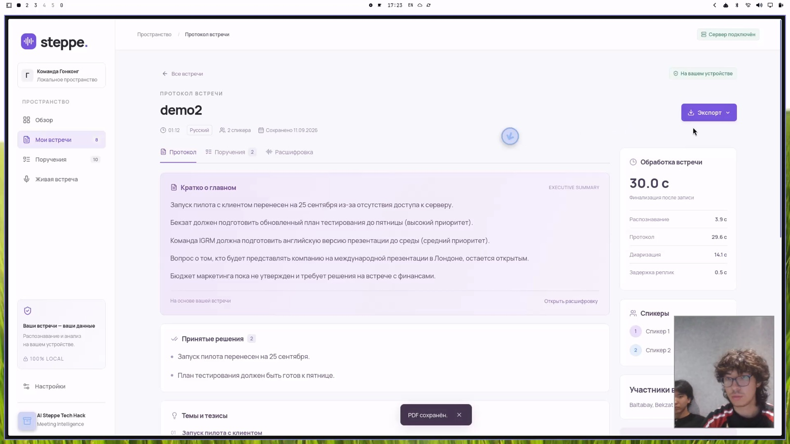
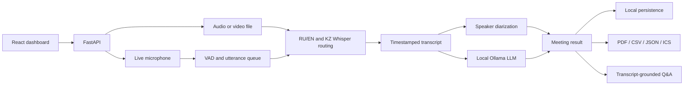

# Steppe — Local Multilingual Meeting Intelligence

**3rd Place among 30 teams · AI Steppe Tech Hackathon 2026 · ₸200,000 prize**

Steppe turns live or uploaded Kazakh, Russian, and English meetings into a
speaker-labelled transcript and a structured protocol. Speech recognition,
diarization, protocol generation, and meeting Q&A run on the user's computer
without cloud APIs at runtime.



## Why we built it

Teams lose decisions, owners, and deadlines after meetings. The problem is
harder in Kazakhstan because one conversation can switch naturally between
Kazakh, Russian, and English, while sensitive meeting audio may not be allowed
to leave the organization.

Steppe keeps the audio and models local and produces a result that the team can
review immediately after the conversation.

## Product workflow

1. Record a meeting from the server microphone or upload an audio/video file.
2. Watch utterances appear during a live meeting.
3. Finish the meeting and receive a structured protocol.
4. Review decisions, topics, open questions, risks, and action items.
5. Ask questions grounded in the transcript and open cited time fragments.
6. Export the result as PDF, CSV, JSON, or an `.ics` calendar file.

## Features

- Live microphone transcription over WebSocket
- Audio and video upload (`mp3`, `wav`, `m4a`, `mp4`, `mov`, `webm`, and more)
- Kazakh, Russian, and English speech with code-switching
- Speaker diarization with word-level alignment
- Executive summary, decisions, topics, open questions, and risks
- Action items with owner, deadline, and priority when stated in the meeting
- Local meeting Q&A with cited transcript excerpts
- PDF, CSV, JSON, and calendar export
- Persisted meeting history and locally stored uploaded audio
- Runtime network guard that blocks and counts outbound connections

## Architecture



The demo machine had 6 GB of VRAM, which could not hold both speech and language
models at the same time. Steppe hands the GPU between faster-whisper and Ollama:
speech recognition releases the GPU before protocol generation, then reloads
for the next meeting.

## Measured demo performance

These measurements come from the team's RTX 3060 6 GB laptop and an internal
77-second RU/KZ/EN recording. They describe that setup and are not a general
accuracy benchmark.

| Measurement | Result |
| --- | ---: |
| Routed transcription | 3.4 s (22.7× realtime) |
| Upload to protocol | 20 s |
| Live 6-second utterance | 0.35 s |
| Protocol generation | approximately 10–16 s |
| CPU diarization of the 77-second clip | approximately 25 s |

The routed build preserved the Kazakh utterances and the English deadline in
the team's test recording; stock Whisper `medium` dropped or mistranslated
those parts. See [technical decisions](docs/DECISIONS.md) for the comparison and
the limits of the measurement.

## Technology

| Layer | Stack |
| --- | --- |
| Frontend | React, TypeScript, Vite, IndexedDB |
| API and live stream | FastAPI, WebSocket, Python 3.13 |
| Speech recognition | faster-whisper, CTranslate2, dedicated RU/EN and KZ models |
| Voice activity and speakers | sherpa-onnx VAD and offline diarization |
| Protocol and Q&A | Ollama with `qwen3.5:4b` |
| Exports | ReportLab, CSV/JSON serializers, iCalendar generation |
| Privacy | Offline model loading and an in-process network guard |

## Running locally

Model weights are intentionally excluded from Git. The first setup needs an
internet connection to install dependencies and download the models. Runtime
processing can then operate offline.

Prerequisites:

- Python 3.13 and [`uv`](https://docs.astral.sh/uv/)
- Node.js and npm for the frontend build
- [Ollama](https://ollama.com/)
- A CUDA-capable GPU is recommended for the demonstrated performance

```bash
git clone https://github.com/gojosatorukz/steppe-meeting-intelligence.git
cd steppe-meeting-intelligence

(cd api && uv sync)
make models

# Convert the dedicated Kazakh model once:
(cd api && uv run ct2-transformers-converter \
  --model shyngys879/kazakh-whisper-large-v3-turbo \
  --output_dir models/kk-turbo-ct2 \
  --copy_files tokenizer.json preprocessor_config.json \
  --quantization int8)

ollama pull qwen3.5:4b
make frontend
cp .env.example .env
make dev
```

Open [http://localhost:8000](http://localhost:8000). The health endpoint shows
which models are ready and whether the offline guard has observed any blocked
network attempts.

## Validation

```bash
cd frontend
npm ci --no-audit --no-fund
npm test
npm run build

cd ../api
uv run pytest -q
```

The Python suite contains model-gated integration tests. Tests that need a GPU,
Ollama, or local weights skip when those resources are unavailable.

## Repository structure

```text
api/
  main.py             FastAPI routes, persistence, uploads, exports, and chat
  pipeline.py         multilingual STT routing and protocol generation
  live.py             microphone capture, VAD queue, and WebSocket events
  diarize.py          offline speaker diarization
  offline_guard.py    runtime outbound-network protection
  ics.py              calendar export
frontend/
  src/                React dashboard and API integration
docs/
  DECISIONS.md        technical decisions and measured trade-offs
  DEMO.md             hackathon demo runbook
scripts/              setup, preflight, and local startup scripts
```

## Team and contributions

### Bekzat Rashiduly — AI engineer, product, and frontend

- Designed and implemented the React/TypeScript dashboard
- Connected upload, live transcription, history, protocol, Q&A, and export APIs
- Integrated AI-generated transcripts, protocols, and grounded answers into the product workflow
- Built the result, transcript, action-item, and live-meeting experiences
- Added local browser persistence and responsive UI states
- Prepared the product demo, one-pager, and two-minute pitch

### Zhanybek Baltabay — AI and backend

- Built the FastAPI service and real-time audio pipeline
- Implemented RU/EN and Kazakh speech-model routing
- Added local Ollama protocol generation and transcript-grounded Q&A
- Implemented VAD, speaker diarization, GPU handoff, persistence, and exports
- Added offline safeguards, model checks, and backend integration tests

## Award

Steppe won **3rd place among 30 teams and a ₸200,000 prize at AI Steppe Tech
Hackathon 2026**.
This repository contains the working system demonstrated by the team, followed by
small documentation improvements made for this public portfolio version.

## Publication and license

The team approved publication of the code and included test recordings. Model
weights are not part of this repository and remain subject to their original
licenses. This repository currently does not grant an open-source license;
default copyright restrictions apply.
